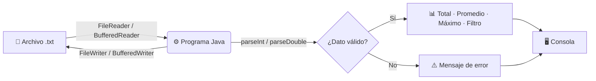

<div align="center">


<a href="https://git.io/typing-svg">
  
</a>


**SW-AyLP-APE-05 · Algoritmos y Lógica de Programación · Ciclo julio – diciembre 2026**

</div>

---

## 🧭 La misión

Un programa normal vive y muere en la memoria RAM: al cerrarlo, todo desaparece.
En esta APE el equipo le enseñó a **recordar**. Con las clases de `java.io` cada programa **crea, lee y escribe archivos de texto**, guarda información entre ejecuciones y la procesa con contadores, promedios, máximos y filtros, validando siempre que el archivo exista y que los datos sean correctos.



---

## 👥 El equipo de exploradores

<div align="center">

| | Integrante | Misiones | Rama |
|:-:|:--|:-:|:--|
| 🕵️ | **Alulema Chato Sandra Jazmin** | 1 y 2 | `sandra-ej01-ej02` |
| 🧑‍💻 | **Armas Jaya Anthony Daniel** · [@Anthony-GTX](https://github.com/Anthony-GTX) | 3 y 4 | `anthony-ej03-ej04` |
| 📚 | **Guaman Sagñay Joselyn Maribel** | 5 y 6 | `joselyn-ej05-ej06` |
| 🎮 | **Ortiz Mosquera Valeria Valentina** | 7 y 8 | `valeria-ej07-ej08` |
| ☕ | **Vayas Masache Andrés Gabriel** | 9 y 10 | `andres-ej09-ej10` |

</div>

### Lo que hizo cada integrante

<details open>
<summary><b>🕵️ Sandra Alulema · Misiones 1 y 2 — Lectura</b></summary>

- **Ejercicio 1 · Agencia de detectives.** Lee `pistas.txt` línea por línea con `BufferedReader`, muestra cada pista y cuenta cuántas hay.
- **Ejercicio 2 · Estación espacial.** Lee `mensaje.txt` carácter por carácter con `FileReader` y `read()`, muestra el mensaje y cuenta el total de caracteres.
- Archivos de código: `Ejercicio01_AgenciaDetectives.java`, `Ejercicio02_EstacionEspacial.java`.
</details>

<details open>
<summary><b>🧑‍💻 Anthony Armas · Misiones 3 y 4 — Clasificación y totales</b></summary>

- **Ejercicio 3 · Museo digital.** Lee `obras.txt` (obra y categoría), muestra las obras y clasifica cuántas hay por categoría con un `LinkedHashMap`.
- **Ejercicio 4 · Parque de aventuras.** Lee `resultados.txt` con `BufferedReader`, calcula el puntaje total e identifica el puntaje más alto.
- Archivos de código: `Ejercicio03_MuseoDigital.java`, `Ejercicio04_ParqueAventuras.java`.
</details>

<details open>
<summary><b>📚 Joselyn Guaman · Misiones 5 y 6 — Escritura sin borrar</b></summary>

- **Ejercicio 5 · Biblioteca inteligente.** Menú para registrar libros sin eliminar los anteriores, listar títulos, buscar un libro, contar los registros y validar que `libros.txt` exista.
- **Ejercicio 6 · Mensajes secretos.** Escribe en `secreto.txt` con `FileWriter` y `BufferedWriter` en modo anexar, lee con `BufferedReader`, cuenta las líneas y controla los errores de entrada y salida.
- Archivos de código: `Ejercicio05_BibliotecaInteligente.java`, `Ejercicio06_MensajesSecretos.java`.
</details>

<details open>
<summary><b>🎮 Valeria Ortiz · Misiones 7 y 8 — De texto a números</b></summary>

- **Ejercicio 7 · Competencia de videojuegos.** Convierte las puntuaciones de `jugadores.txt` a números, calcula el promedio, encuentra al mejor jugador, filtra a los de más de 70 puntos y descarta los registros con formato inválido.
- **Ejercicio 8 · Control de temperatura.** Guarda temperaturas en `temperaturas.txt`, calcula promedio y máxima, cuenta cuántas superan los 30 grados y controla los datos no numéricos.
- Archivos de código: `Ejercicio07_CompetenciaVideojuegos.java`, `Ejercicio08_ControlTemperatura.java`.
</details>

<details open>
<summary><b>☕ Andrés Vayas · Misiones 9 y 10 — Validación y ventas</b></summary>

- **Ejercicio 9 · Diario de exploradores.** Escribe descubrimientos al final de `descubrimientos.txt`, los lee y cuenta, busca uno por nombre y valida que el archivo exista y no esté vacío.
- **Ejercicio 10 · Cafetería.** Registra ventas con `BufferedWriter`, suma el total de `ventas.txt`, identifica el producto más caro, filtra por un valor mínimo y rechaza los precios incorrectos.
- Archivos de código: `Ejercicio09_DiarioExploradores.java`, `Ejercicio10_VentasCafeteria.java`.
</details>

---

## 🗺️ Mapa de misiones

| # | Misión | Archivo | Clases y métodos clave |
|:-:|:--|:--|:--|
| 1 | 🕵️ Agencia de detectives | `pistas.txt` | `BufferedReader`, `readLine()` |
| 2 | 🚀 Estación espacial | `mensaje.txt` | `FileReader`, `read()` |
| 3 | 🖼️ Museo digital | `obras.txt` | `split()`, `LinkedHashMap` |
| 4 | 🏞️ Parque de aventuras | `resultados.txt` | `Integer.parseInt()` |
| 5 | 📚 Biblioteca inteligente | `libros.txt` | `FileWriter(archivo, true)`, `File.exists()` |
| 6 | 🔐 Mensajes secretos | `secreto.txt` | `BufferedWriter`, `newLine()` |
| 7 | 🎮 Competencia de videojuegos | `jugadores.txt` | `Double.parseDouble()`, `ArrayList` |
| 8 | 🌡️ Control de temperatura | `temperaturas.txt` | `try-catch`, `NumberFormatException` |
| 9 | 🧭 Diario de exploradores | `descubrimientos.txt` | `File.length()`, `equalsIgnoreCase()` |
| 10 | ☕ Cafetería | `ventas.txt` | `StringBuilder`, filtro por umbral |

---

## 📁 Estructura del proyecto

```text
APE-5-FINAL/
├── codigos/     Ejercicio01 … Ejercicio10 (archivos .java)
├── datos/       pistas.txt, mensaje.txt, obras.txt, resultados.txt,
│                jugadores.txt, temperaturas.txt, ventas.txt
└── README.md
```

## ▶️ Cómo ejecutarlo

Requiere **JDK 17 o superior**. Los archivos `.txt` deben estar en el directorio de trabajo.

```bash
javac -encoding UTF-8 -d bin codigos/*.java
cd datos
java -cp ../bin Ejercicio01_AgenciaDetectives
```

Cambia el nombre de la clase para ejecutar cualquier otra misión. Los ejercicios 5, 6, 8, 9 y 10 muestran un menú interactivo.

<details>
<summary><b>🖥️ Ejemplo de salida · Ejercicio 7</b></summary>

```text
Puntuación inválida: Carla,abc
Formato inválido: Juan
Promedio: 77.75
Mayor puntaje: María (92.0)
Jugadores con puntuación superior a 70:
- Ana: 85.0
- María: 92.0
- Pedro: 74.0
```
</details>

<details>
<summary><b>🌿 Flujo de trabajo con ramas</b></summary>

Cada integrante trabaja sus ejercicios en su propia rama y la une a `main` con un pull request.

```bash
git checkout -b anthony-ej03-ej04
git add codigos/Ejercicio03_MuseoDigital.java codigos/Ejercicio04_ParqueAventuras.java
git commit -m "Ejercicios 3 y 4: museo digital y parque de aventuras"
git push -u origin anthony-ej03-ej04
```
</details>

---

## 🎓 Lo que aprendimos

| Concepto | Dónde se usó |
|:--|:--|
| Leer línea por línea y carácter por carácter | Ejercicios 1 al 4 |
| Anexar al final sin sobrescribir | Ejercicios 5, 6, 8, 9 y 10 |
| Convertir texto a número y validarlo | Ejercicios 4, 7, 8 y 10 |
| Validar la existencia del archivo con `File` | Ejercicios 5, 6, 7 y 9 |
| Controlar errores con `try-catch` y `try-with-resources` | Los 10 ejercicios |

---

<div align="center">

**Docente:** Ing. José Rubén Caiza Caizabuano, Mg.
**Universidad Técnica de Ambato** · Facultad de Ingeniería en Sistemas, Electrónica e Industrial · Carrera de Ingeniería en Software


</div>
